<div align="center">

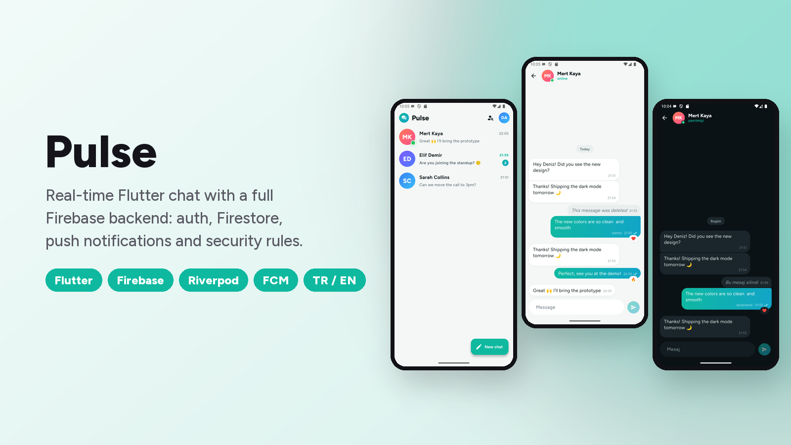

# Pulse · Flutter + Firebase Sohbet

Eksiksiz bir Firebase altyapısıyla gerçek zamanlı bir mesajlaşma uygulaması:
- E-posta ve Google ile giriş.
- Cloud Firestore üzerinde canlı birebir sohbetler.
- "Yazıyor…" göstergesi, okundu bilgisi, tepkiler ve çevrimiçi durumu.
- Anlık bildirimler.
- Test edilmiş güvenlik kuralları.

[](https://flutter.dev)
[](https://firebase.google.com)
[](https://riverpod.dev)
[](https://github.com/SafaSenturk/flutter-firebase-chat/actions/workflows/ci.yml)
[](LICENSE)

**[⬇️ APK'yı indir](https://github.com/SafaSenturk/flutter-firebase-chat/releases/latest)** · [🇬🇧 English](#-english)

</div>

---

## Demo

<p align="center">
  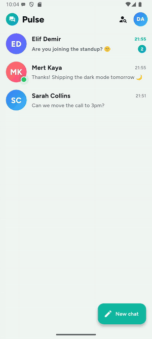
</p>

<p align="center"><i>Gönder → karşı taraf okur (✓✓) → "yazıyor…" → cevap gelir → tepki. Hepsi Firestore üzerinden canlı.</i></p>

## Özellikler

**Kimlik doğrulama (Firebase Auth)**
- E-posta ve şifreyle kayıt / giriş, doğrulama ve şifre gücü göstergesiyle.
- **Google ile giriş** (Android'de Credential Manager).
- E-postayla şifre sıfırlama, çıkış yapma.
- Her Auth hatası için anlaşılır mesajlar: yanlış şifre, kullanımda olan e-posta, internet yok…

**Sohbet (Cloud Firestore, gerçek zamanlı)**
- Son etkinliğe göre sıralanan sohbet listesi; **okunmamış rozetleri** ve canlı önizlemeler.
- **"Yazıyor…" göstergesi** (listede ve sohbetin içinde), **çevrimiçi / son görülme**.
- **Okundu bilgisi:** gönderiliyor ⏱ → gönderildi ✓ → okundu ✓✓.
- Mesaja uzun basınca **tepki** (❤️ 😂 👍 😮 😢 🔥), **kopyala**, **düzenle** ya da **sil**.
- Gün ayraçları, gruplanmış balonlar, yumuşak giriş animasyonları.
- Çevrimdışı çalışır: Firestore önbelleği geçmişi gösterir, mesajları bağlantı gelene kadar sıraya alır.

**Bildirimler (FCM)**
- Cihaz token'ları kullanıcı başına kaydedilir; bildirime dokununca **doğru sohbet açılır**.
- Diğer sohbetlerden gelen mesajlar için uygulama içi bildirimler.
- Yayına hazır bir **Cloud Function** ([`functions/index.js`](functions/index.js)): her yeni mesajı alıcının cihazlarına gönderir, eskimiş token'ları temizler.

**Arka uç kalitesi**
- **Güvenlik kuralları** ([`firestore.rules`](firestore.rules)):
  - Kullanıcılar yalnızca kendi profillerini yazar.
  - Bir sohbeti yalnızca iki üyesi görebilir.
  - Mesajlar yalnızca kendi adına ve 1–2000 karakter olarak gönderilir.
  - Alıcı yalnızca okundu işaretleyebilir ve tepki verebilir.
- Firebase Emulator üzerinde **12 kural testi** ([`rules-tests/`](rules-tests/rules.test.js)), CI'da çalışır.
- Sohbet listesi için birleşik indeks: [`firestore.indexes.json`](firestore.indexes.json).
- Android API anahtarı bu uygulamanın paketine ve imza sertifikalarına kısıtlı.

**Uygulama**
- İsimle aranabilen kişi listesi.
- Profil: ad, hakkımda, avatar rengi, **Türkçe / İngilizce**, **açık / koyu tema**.

## Ekran görüntüleri

| Giriş | Kayıt | Şifre sıfırlama | Sohbetler |
|:---:|:---:|:---:|:---:|
| 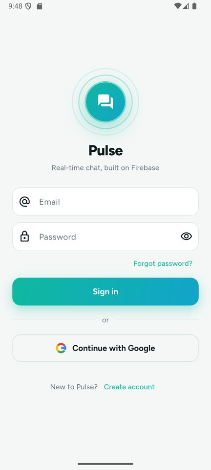 | 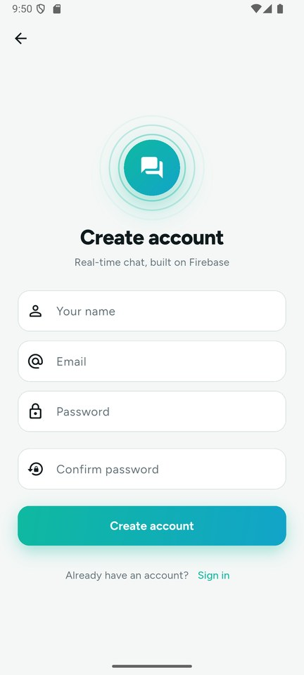 | 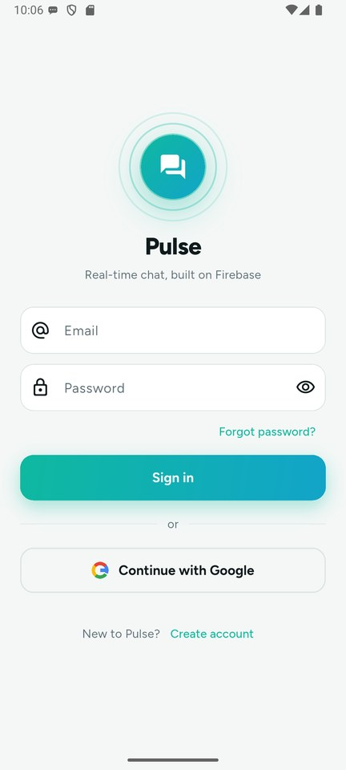 | 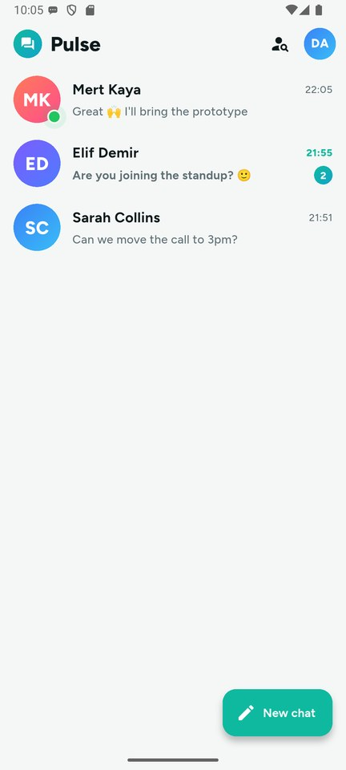 |
| **Konuşma** | **"Yazıyor…" göstergesi** | **Tepki · düzenle · sil** | **Kişiler** |
| 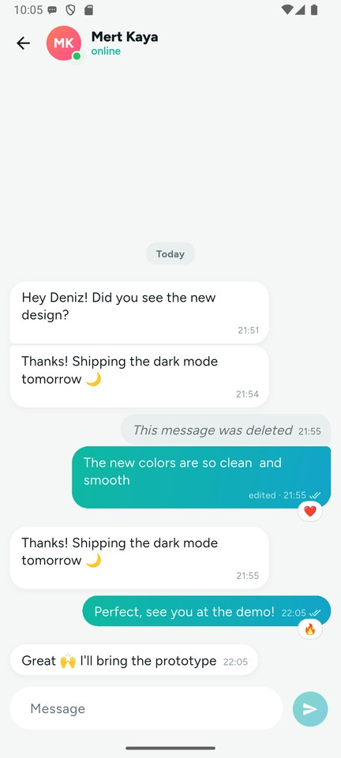 | 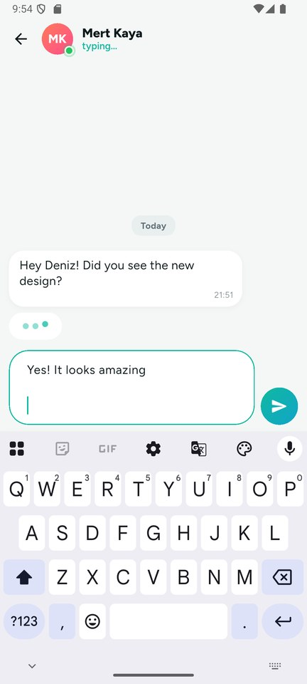 | 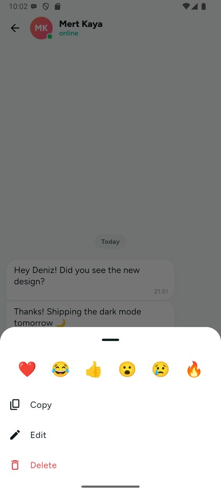 | 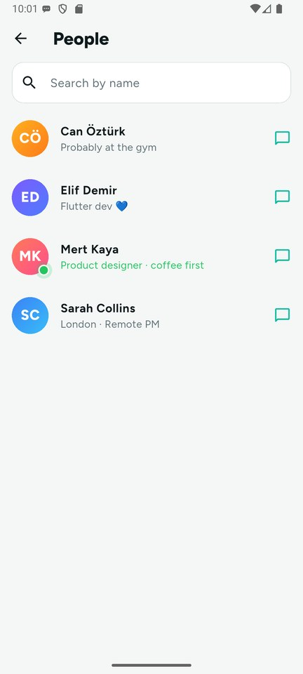 |
| **Profil** | **Anlık bildirimler** | **Koyu · Türkçe** | **Koyu · Türkçe** |
| 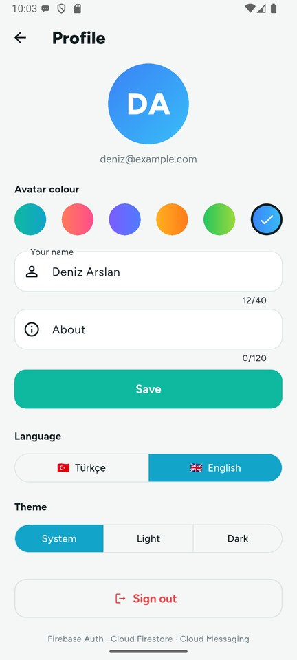 | 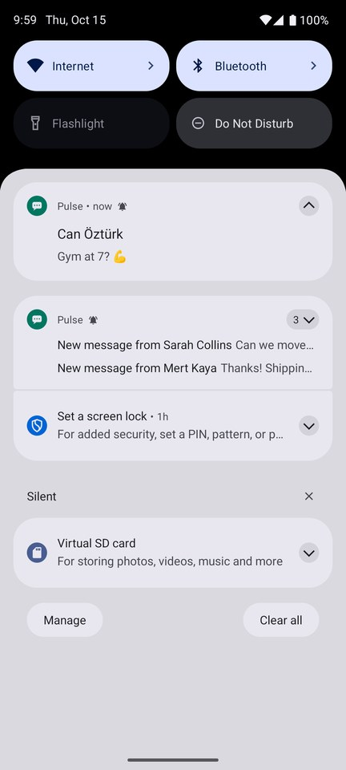 | 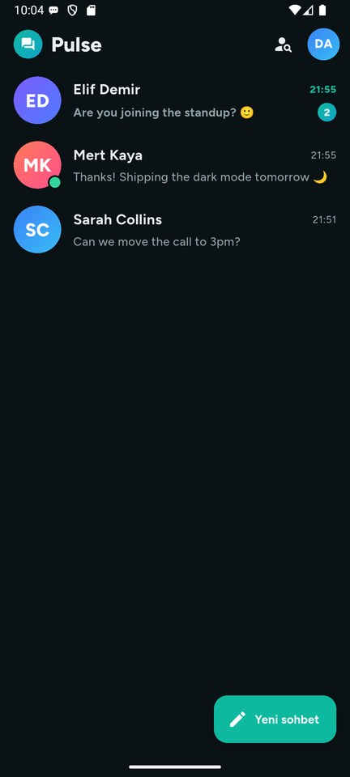 | 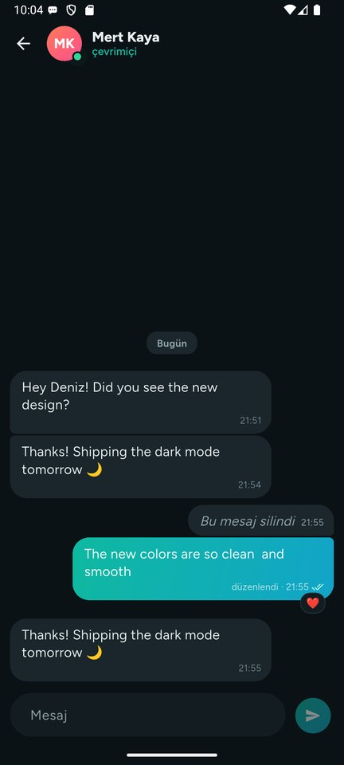 |

## Teknolojiler

| Alan | Seçim |
|---|---|
| Uygulama | Flutter 3.44, Material 3, Riverpod 3 (`StreamProvider`, `Notifier`), giriş yönlendirmeli go_router |
| Kimlik doğrulama | `firebase_auth` (e-posta/şifre, `google_sign_in` 7 ile Google) |
| Veritabanı | Gerçek zamanlı snapshot'larla `cloud_firestore`, toplu yazma (batch), `FieldValue.increment` / `serverTimestamp` |
| Bildirim | `firebase_messaging` + `flutter_local_notifications`; Cloud Functions v2 (Node 22) |
| Güvenlik | Firestore kuralları + emülatörde `@firebase/rules-unit-testing` |
| Yerelleştirme | ARB dosyaları + `gen-l10n`, Türkçe ve İngilizce |
| CI | GitHub Actions: `flutter analyze`, `flutter test`, güvenlik kuralı testleri |

## Veri modeli

```
users/{uid}
  name, nameLower, email, about, colorIndex, online, lastSeen, fcmTokens[]

chats/{uidA_uidB}                     ← id = iki kullanıcı id'si, sıralı
  members[2], updatedAt
  lastMessage { text, senderId, sentAt, deleted }
  unread { uid: sayı }                ← gönderen artırır, okuyan sıfırlar
  typing { uid: zaman }               ← "yazıyor…" = son birkaç saniyede sinyal geldi

chats/{chatId}/messages/{id}
  senderId, text, sentAt, readAt, editedAt, deleted, reactions { uid: emoji }
```

Mesaj göndermek **tek bir toplu yazmadır (batch)**: mesaj ve sohbet özeti (son mesaj, okunmamış sayacı, temizlenen "yazıyor") birlikte yazılır. İlk mesaj sohbeti aynı batch içinde oluşturur; kurallar buna `getAfter()` ile izin verir.

## Proje yapısı

```
lib/
├── main.dart                 # Firebase başlatma, çevrimiçi durumu, uygulama içi bildirimler
├── firebase_options.dart
├── core/                     # provider'lar, router, tema, bildirimler, ortak widget'lar
├── data/                     # modeller, AuthRepository, ChatRepository
├── features/
│   ├── auth/                 # giriş, kayıt, şifre sıfırlama
│   ├── chats/                # sohbet listesi
│   ├── chat/                 # konuşma, balonlar, mesaj yazma alanı, eylemler
│   ├── people/               # kişi listesi
│   └── profile/              # profil, dil, tema, çıkış
└── l10n/                     # app_en.arb, app_tr.arb
functions/                    # Cloud Function: yeni mesajda bildirim gönderir
rules-tests/                  # Firestore kural testleri (emülatör)
firestore.rules · firestore.indexes.json · firebase.json
```

## Kendin çalıştır

```bash
git clone https://github.com/SafaSenturk/flutter-firebase-chat.git
cd flutter-firebase-chat
flutter pub get
flutter run
```

Depo, demo Firebase projesine bağlı. Kendi projeni kullanmak için:
1. Bir Firebase projesi oluştur, E-posta/Şifre ve Google girişini aç.
2. `flutterfire configure` çalıştır.
3. `firebase deploy --only firestore` çalıştır.
4. Sunucu taraflı bildirimler için Blaze planında `firebase deploy --only functions` çalıştır.

```bash
flutter test                         # birim testleri
cd rules-tests && npm ci && npm test # emülatörde güvenlik kuralları (Java gerekir)
```

> **APK'yı denerken:** bir hesap oluştur (kayıt için herhangi bir e-posta olur), sonra **Kişiler** ekranından sohbet başlat. Canlı mesajlaşmayı görmek için uygulamayı ikinci bir telefona kur ya da bir arkadaşınla paylaş.

Kendi uygulaman için giriş, veritabanı, bildirim ve güvenlik kurallarıyla tam bir Firebase altyapısı mı lazım? **[safasenturk.github.io](https://safasenturk.github.io)**

### 🧩 Bu projeden çıkan eklentiler

Bu uygulamadaki şu parçaları başka projelerde de kullanılabilsin diye **[Plugins](https://github.com/SafaSenturk/Plugins)** reposuna ekledim. Oradan erişip kendi projene kopyalayabilirsin:

- **[firestore-chat-kit](https://github.com/SafaSenturk/Plugins/tree/main/firestore-chat-kit)**: sohbet veri katmanı, güvenlik kuralları, kural testleri ve bildirim fonksiyonu.

---

## 🇬🇧 English

**Pulse** is a real-time messaging app with a complete Firebase backend:
- Email and Google sign-in.
- Live one-to-one chats in Cloud Firestore.
- Typing indicators, read receipts, reactions and presence.
- Push notifications.
- Tested security rules.

The demo, screenshots, data model and project structure are shown above. **[⬇️ Download the APK](https://github.com/SafaSenturk/flutter-firebase-chat/releases/latest)**

### Features

**Authentication (Firebase Auth)**
- Email & password sign-up / sign-in with validation and a password strength meter.
- **Google Sign-In** (Credential Manager on Android).
- Password reset by email, sign out.
- Friendly messages for every Auth error: wrong password, email in use, no network…

**Chat (Cloud Firestore, real time)**
- Chat list ordered by latest activity, with **unread badges** and live previews.
- **Typing indicator** (in the list and inside the chat), **online / last seen** presence.
- **Read receipts:** sending ⏱ → sent ✓ → read ✓✓.
- Long-press a message to **react** (❤️ 😂 👍 😮 😢 🔥), **copy**, **edit** or **delete**.
- Day separators, grouped bubbles, smooth enter animations.
- Works offline: Firestore's cache shows history and queues messages until the connection is back.

**Notifications (FCM)**
- Device tokens are registered per user; tapping a notification **opens the right chat**.
- In-app notifications for messages in other chats.
- A ready-to-deploy **Cloud Function** ([`functions/index.js`](functions/index.js)) pushes every new message to the recipient's devices and cleans up stale tokens.

**Backend quality**
- **Security rules** ([`firestore.rules`](firestore.rules)):
  - Users only write their own profile.
  - Only the two members can see a chat.
  - Messages must be sent as yourself, 1–2000 characters.
  - The recipient can only mark messages read and react.
- **12 rule tests** with the Firebase Emulator ([`rules-tests/`](rules-tests/rules.test.js)), run in CI.
- Composite index for the chat list in [`firestore.indexes.json`](firestore.indexes.json).
- The Android API key is restricted to this app's package and signing certificates.

**App**
- People directory with name search.
- Profile: name, about, avatar colour, **Turkish / English**, **light / dark** theme.

### Tech stack

| Area | Choice |
|---|---|
| App | Flutter 3.44, Material 3, Riverpod 3 (`StreamProvider`, `Notifier`), go_router with auth redirect |
| Auth | `firebase_auth` (email/password, Google via `google_sign_in` 7) |
| Database | `cloud_firestore` with real-time snapshots, batched writes, `FieldValue.increment` / `serverTimestamp` |
| Push | `firebase_messaging` + `flutter_local_notifications`; Cloud Functions v2 (Node 22) |
| Security | Firestore rules + `@firebase/rules-unit-testing` on the emulator |
| Localization | ARB files + `gen-l10n`, Turkish & English |
| CI | GitHub Actions: `flutter analyze`, `flutter test`, security-rule tests |

Sending a message is **one batched write**: the message plus the chat summary (last message, unread counter, typing cleared). The first message creates the chat in the same batch, which the rules allow through `getAfter()`.

### Run it yourself

```bash
git clone https://github.com/SafaSenturk/flutter-firebase-chat.git
cd flutter-firebase-chat
flutter pub get
flutter run
```

The repo points at the demo Firebase project. To use your own:
1. Create a project and enable Email/Password and Google sign-in.
2. Run `flutterfire configure`.
3. Run `firebase deploy --only firestore`.
4. For server-side pushes, run `firebase deploy --only functions` on the Blaze plan.

> **Trying the APK:** create an account (any email works for sign-up), then open **People** to start a chat. To see real-time messaging, install it on a second phone, or share it with a friend.

Need a full Firebase backend for your app, with sign-in, database, notifications and security rules? **[safasenturk.github.io](https://safasenturk.github.io)**

### 🧩 Reusable plugins from this app

These parts of the app are available in the **[Plugins](https://github.com/SafaSenturk/Plugins)** repo, ready to copy into your own project:

- **[firestore-chat-kit](https://github.com/SafaSenturk/Plugins/tree/main/firestore-chat-kit)**: the chat data layer, security rules, rule tests and the push function.

---

<div align="center">

**[Safa Şentürk](https://github.com/SafaSenturk)** · Flutter Mobil Geliştirici · Flutter Mobile Developer · [Portföy / Portfolio](https://safasenturk.github.io)

</div>
